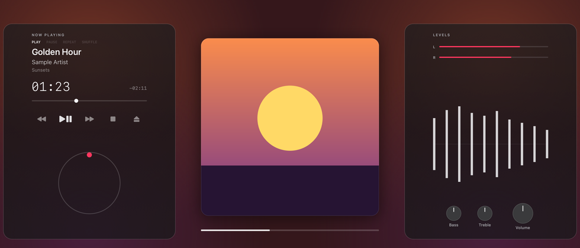
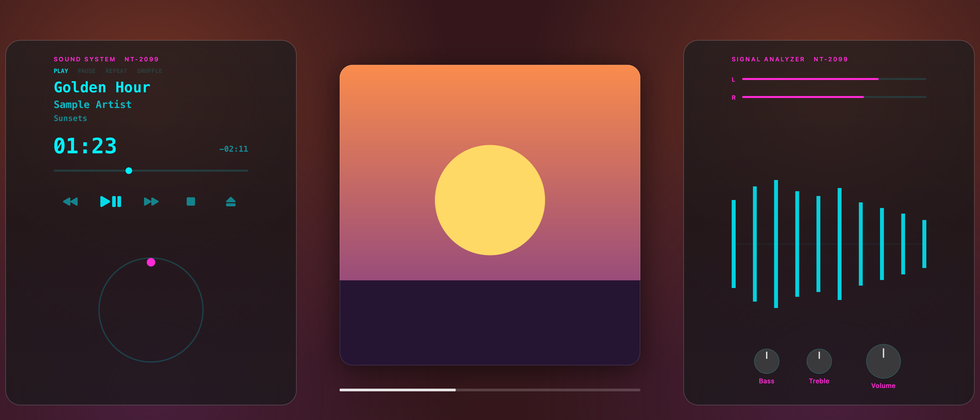
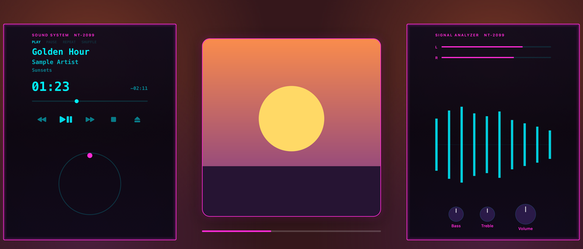
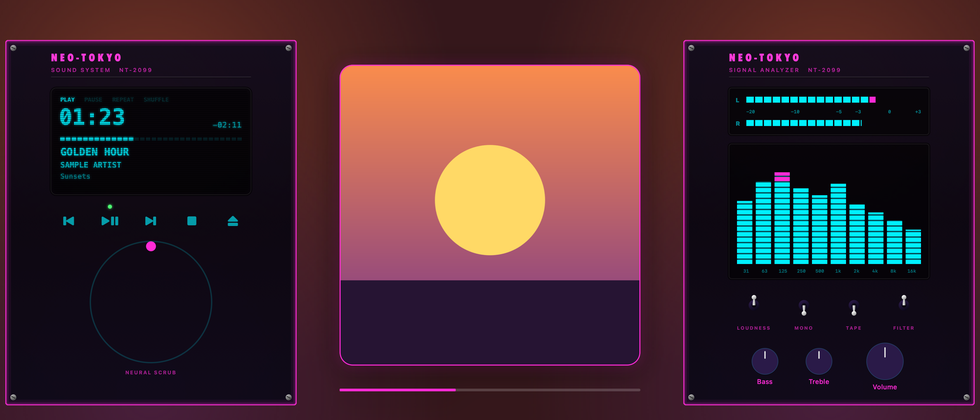

# Make your own look: a cyberpunk skin, step by step

This walks through making a cyberpunk look for Himawari's side gear, from a copy of a built-in skin
to a whole era of your own. Every step is a small JSON file you edit in any text editor. Himawari
reloads it as soon as you save, so the desktop changes while you work.

The files for each step are next to this page, in [`make-your-own/`](make-your-own/). The finished
look also ships with Himawari: pick **Cyberpunk ▸ Neon** in **Style…**.

## 0. Start from a built-in skin



1. Open **Himawari menu ▸ Style…** and pick **Today, Minimal ▸ Dark**.
2. Press **Make My Own…**. Himawari saves a copy as `my-minimal-dark.json` in
   `~/Library/Application Support/Himawari/Skins/`, opens it, and selects it.

The copy lists every setting the skin has. You only need to keep what you change, plus the five
lines that say what the skin is:

```json
{
  "format": 1,
  "id": "my-neon",
  "name": "My Neon",
  "era": "minimal",
  "base": "minimal-dark"
}
```

`base` is the built-in skin everything else comes from. `id` is the file's name for the skin:
lowercase letters, digits and dashes.

## 1. Colours


Add the four colours that light the gear ([1-colours.json](make-your-own/1-colours.json)):

```json
"colors": {
  "display": "#00F0FF",
  "accent": "#FF2BD6",
  "peak": "#FFE600",
  "label": "#FF2BD6"
}
```

| Colour | What it lights |
|---|---|
| `display` | The song, the time, the progress, the waveform |
| `accent` | The level lines, the dot on the ring, lamps |
| `peak` | The loudest segments of LED meters |
| `label` | The printing on the faceplate |

Colours are `#RRGGBB`, or `#RRGGBBAA` to make them see-through.

## 2. Lettering



Give the gear its own names and fonts ([2-lettering.json](make-your-own/2-lettering.json)):

```json
"brand": "NEO-TOKYO",
"models": { "left": "SOUND SYSTEM   NT-2099", "right": "SIGNAL ANALYZER   NT-2099" },
"fonts": { "brand": "Futura-CondensedExtraBold", "display": "Menlo-Bold" }
```

Fonts are the names Font Book shows under **Show Font Info** (PostScript names). `null` goes back to
the system font. Today's minimal era prints the model names; the brand shows in eras with a
header, like the one in step 4.

## 3. Materials and shape



Make the panels near-black and sharp-cornered, and give them a glowing edge
([3-materials.json](make-your-own/3-materials.json)):

```json
"material": "neon",
"layout": { "corner": 4 },
"colors": {
  "plate": ["#0E0A1CE6", "#07050FE6", "#0B0817E6"],
  "button": ["#1C1236", "#0A0618"],
  "knob": ["#2A1A48", "#0A0618"],
  ...
}
```

- `neon` draws a tube of light in the `accent` colour around each panel, and around the cover's card.
  The other materials are `brushed`, `chrome`, `plastic` and `matte`.
- `plate` is the faceplate's top, middle and bottom. The `E6` on the end lets a little of the
  wallpaper's glow through.
- The layout can also set `columnWidth` (200 to 360), `gap` (4 to 16) between buttons, and
  `caseWidth` (0 to 30) for a wooden case.

## 4. Your own era



So far the skin has only changed how the minimal era looks. A **design** changes what's on the
panels. Save [my-cyberpunk.json](make-your-own/my-cyberpunk.json) in
`~/Library/Application Support/Himawari/Designs/`:

```json
{
  "format": 1,
  "id": "my-cyberpunk",
  "name": "My Cyberpunk",
  "media": "card",
  "left": [
    { "block": "header" },
    { "block": "display", "style": "vfd", "height": 160 },
    { "block": "buttons", "style": "bare", "height": 40 },
    { "block": "wheel", "style": "ring", "label": "NEURAL SCRUB" },
    { "block": "spacer", "height": 8 }
  ],
  "right": [
    { "block": "header" },
    { "block": "meters", "style": "leds", "height": 70 },
    { "block": "spectrum" },
    { "block": "toggles" },
    { "block": "knobs", "style": "flat" }
  ]
}
```

Each panel is a list of blocks, stacked from the top. A block with a `height` gets that many points
(fewer on a short screen). The ones without a height share what's left.

Then add one line to the skin ([4-your-own-era.json](make-your-own/4-your-own-era.json)):

```json
"design": "my-cyberpunk"
```

In **Style…** the skin now has a section of its own, **My Cyberpunk**.

| Block | Styles | Notes |
|---|---|---|
| `header` | | The brand and the model name |
| `display` | `vfd`, `lcd`, `glass`, `dial` | The song, the time and the progress. `dial` is a tuning dial whose pointer travels through the song |
| `buttons` | `rounded`, `keys`, `round`, `flat`, `bare` | Previous, play/pause, next, stop, eject |
| `wheel` | `knurled`, `ring`, `clickwheel` | Turn it to scrub. A `label` prints under it |
| `meters` | `needles`, `leds`, `spectrum` | The left and right levels |
| `spectrum` | | Ten bands |
| `knobs` | `classic`, `flat`, `touch` | Bass, treble, volume |
| `grille`, `toggles`, `sliders`, `gamepad`, `power`, `spacer` | | For looks: a speaker, switches, equalizer sliders, a D-pad and face buttons, the power switch, a gap |

A design needs exactly one `display`, one `buttons`, one `wheel` and one `knobs`, on either side.

`media` is what plays in the middle: `cd`, `record`, `cassette`, `discman` (a CD under a portable
player's lid), `player` (a pocket player), `card` (the cover floating) or `cartridge` (a handheld's
game cartridge with the cover on its label).

## 5. Share it

Send the skin and the design to a friend. In **Style…** they press **Import…** for the skin and put
the design in their Designs folder. If their own skin already uses the same id, the imported one
gets a new id, so nothing is overwritten.

## When something's wrong

A file with a mistake is skipped, and **Style…** lists it in orange with the reason, for example:

```
my-neon.json: "colors.display": colours are written #RRGGBB or #RRGGBBAA
Designs/my-cyberpunk.json: "left[2].style": one of rounded, keys, round, flat, bare
```

Fix the file and save it: it loads as soon as it's right.
